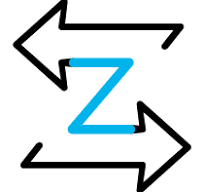

<link rel="preconnect" href="https://fonts.gstatic.com" crossorigin>
<link href="https://fonts.googleapis.com/css2?family=Bebas+Neue&family=Rajdhani:wght@300;400;500&display=swap" rel="stylesheet">

<h1 align="center">Hi I am Niko :alien:,</h1>

<h2 align="center">Cybersecurity Engineer | SOC · DFIR · Detection Engineering</h2>

  I work on cybersecurity projects focused on Active Directory security,
  threat detection, incident response, and digital forensics.

  My background combines software test automation with hands-on cybersecurity
  lab work. I build isolated environments to simulate attacks, collect telemetry,
  develop detection logic, and investigate security events.

 
 

 

 

 

 
 
### :zap: Cybersecurity Projects:
---
#### Active Directory Security & DFIR Lab
<ul style="display: inline-block">
  <li>Simulate Active Directory attack techniques: Kerberoasting, AS-REP Roasting, DCSync, and LSASS credential dumping.</li>
  <li>Develop and validate detection logic using Wazuh, Suricata, and Sysmon.</li>
  <li>Analyze Windows Event Logs, network traffic, and PCAP files</li>
  <li>Correlate security events and build incident timelines</li>
  <li>Practice evidence acquisition, integrity verification, and chain-of-custody documentation</li>
  <li>Document incident investigation and response workflows</li>
</ul>

#### Web & API Security
<ul style="display: inline-block">
  <li>Perform security testing of web applications and APIs</li>
  <li>Practice vulnerability assessment based on OWASP guidance</li>
  <li>Analyze HTTP requests and responses using Burp Suite and Postman</li>
  <li>Document findings and technical reproduction steps</li>
</ul>

#### Web-Penetration-Testing
<ul style="display: inline-block">
  <li>Define Scopes, Gathering Information and Threat Modelling</li>
  <li>Active and Passive reconnaissance <code>Nikto, Shodan, Nmap, Recon-ng</code> etc.</li>
  <li>Exploitation <code>SQLMap, Hashcat</code> etc.</li>
  <li>Post Exploitation <code>Mimikatz, Metasploit, Netcat</code></li>
  <li>Reporting</li>
</ul>

### Background
- Automation Tester — Capgemini Engineering
- System Administrator — National Guard of Ukraine
- Practical cybersecurity projects and independent lab development

<h3>Contact me:</h3>

 
 

